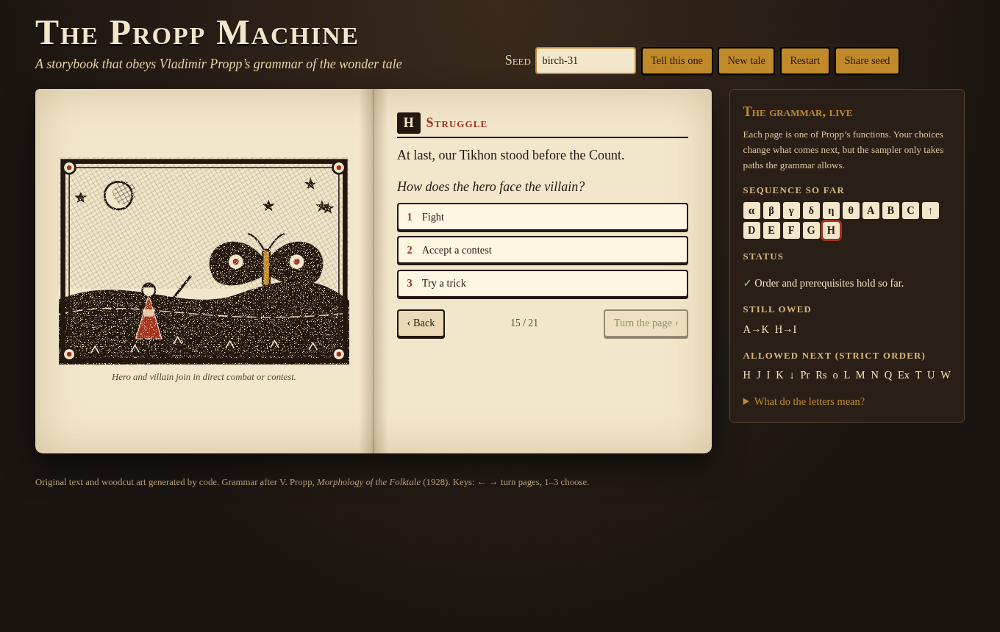

# The Propp Machine

**Play it live:** https://westkitty.github.io/propp-machine/

A formal story grammar after Vladimir Propp's *Morphology of the Folktale*, with four parts:
- a **validator** that explains violations in plain words
- an **annotated corpus** of 12 public-domain tales from Afanas'ev (Magnus translation, 1915), with an acceptance report
- a seeded **tale generator** with an original, funny and eerie cast
- an **interactive storybook reader** whose choices always keep the tale grammatical



## Results at a glance

- **Generator:** 50/50 published tales pass the strict validator (`npm run generate`), as do 2,000 of 2,000 seeds in the test suite.
- **Real tales:** 0/12 pass strict; 2/12 pass refined (*The Realms of Copper, Silver and Gold* and *Iváshko and the Wise Woman*). Order is the rule real tales break most. See `docs/ANALYSIS.md` and `docs/ACCEPTANCE.md`.
- **Diversity:** 988 of 1,000 sequences are distinct (9.94 bits of a possible 9.97). Transition entropy is 0.92 bits against 1.88 for the real tales. Prose distinct-3 rose from 0.24 (v1) to 0.37 (v3). See `docs/METRICS.md`.
- **Reader:** a headless Playwright run with scripted choices completes 3 full tales (desktop and phone), each ending in "Valid tale", with no console errors (`npm run shots`).

The grammar does **not** capture all folktales. See `docs/ESSAY.md`.

## Run it

Node 18+ and no runtime dependencies. `playwright-core` is a dev-only dependency for the headless test.

```sh
npm install              # only needed for npm run shots
npm run fetch-texts      # downloads Gutenberg #62509 into .cache/ (gitignored)
npm test                 # validator, generator and corpus tests (cue quotes checked against the text)
npm run validate-corpus  # strict + refined acceptance -> docs/ACCEPTANCE.md, corpus/results.json
npm run generate         # 50 tales -> tales/*.md, tales/*.json, tales/INDEX.md (exits 1 if any fails)
npm run metrics          # diversity metrics -> docs/metrics.json
npm run serve            # http://127.0.0.1:8090/reader/
npm run shots            # headless reader test + screenshots (uses /usr/bin/google-chrome; set CHROME=...)
```

The reader also works by opening `reader/index.html` directly (file://) or from any subpath, such as GitHub Pages. If you edit `data/grammar.json`, run `npm run sync-data`, which regenerates `reader/data.js`.

## Layout

| Path | What |
|---|---|
| `data/grammar.json` | The 31 functions (plus α, the lack variant a, and X for unidentified episodes), with paraphrased glosses and variants. Also: the 7 spheres of action, pair and prerequisite constraints, and the 8 documented refinements. |
| `src/core/validator.js` | `validate(tale, {mode:'strict'|'refined'})` returns violations with codes ORDER, UNPAIRED, MISSING_PREREQ, NO_COMPLICATION, UNMAPPED, UNMAPPED_EXCESS and UNKNOWN_CODE. `frontier()` gives the allowed next functions and owed pairings. |
| `src/core/generator.js`, `src/core/tables.js` | Seeded planner (one independent PRNG stream per decision, so a reader's choice never shifts earlier pages), cast tables, template sets v1, v2 and v3. |
| `src/core/art.js` | Generated woodcut-style SVG scene for every function, with villain-specific glyphs and gift icons. |
| `reader/` | Static storybook UI with a live grammar panel, seed entry, restart and share-seed. Keyboard: ← → to turn pages, 1–3 to choose. |
| `corpus/tales.json` | 12 annotated tales: Gutenberg ID, line numbers, ≤15-word cues, implicit and X markers, notes. |
| `tales/` | The 50 generated tales. |
| `docs/` | `SOURCES.md` (8 scholarly sources), `PUBLIC_DOMAIN.md`, `ANALYSIS.md`, `ACCEPTANCE.md`, `METRICS.md`, `ESSAY.md`, `BACKLOG.md`. |
| `shots/` | Reader screenshots from the headless run. |

## Honesty notes

- The annotations are one model-assisted reading, checked by script for exact quotations only. There is no second annotator.
- ATU numbers are tentative.
- Two refinement bases are our reading of Propp with unverified page references; they are marked in the data.
- All prose, names and art are original. No tale text is redistributed.
